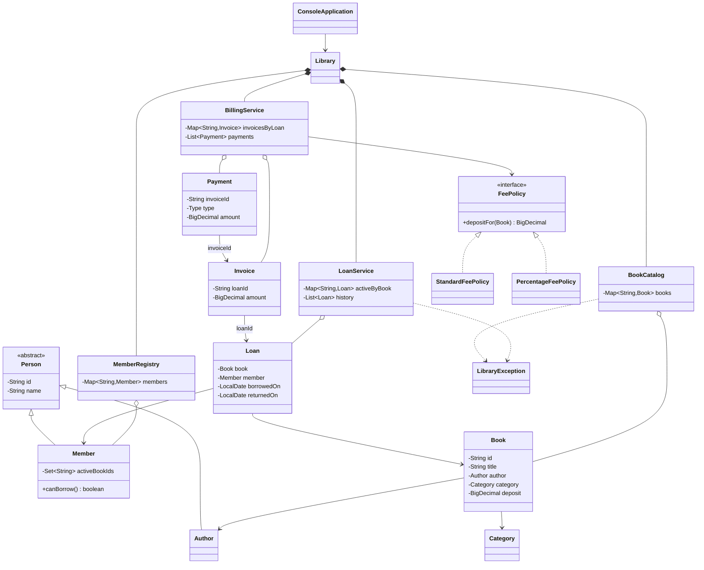

# Sınıf diyagramı

`*--` hizmetlerin `Library` tarafından oluşturulup sahiplenildiğini, `o--` kayıtların ilgili hizmetçe tutulduğunu gösterir. `FeePolicy` uygulaması `Library` oluşturulurken seçilir; `BillingService` onu aynı arayüz üzerinden çağırır. Tek kopyanın aktif ödünç bilgisi `LoanService.activeByBook` haritasındadır.
